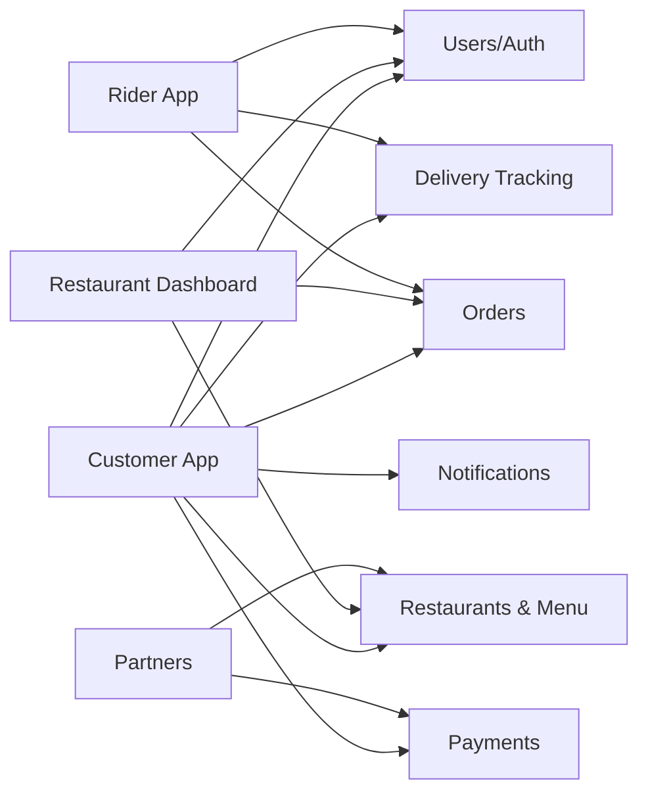
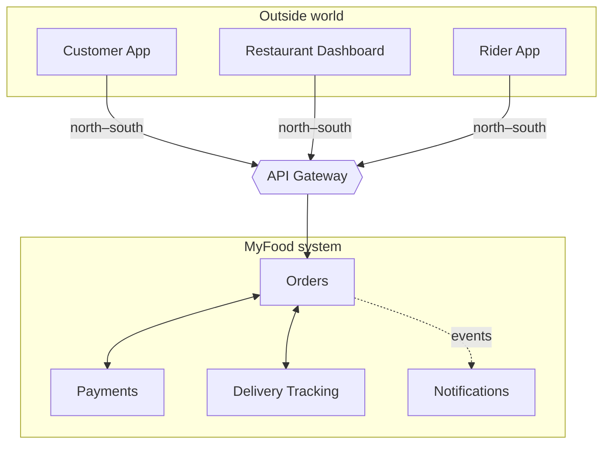

# Part 2 — Why a Gateway Layer? (~4 min)

## Slide 3 — Meet MyFood: Life Without a Gateway

**On slide:**

> **MyFood** — order food from your favourite Lagos restaurants

Without a gateway:
- 🔁 **Chatty clients:** the app makes many calls to load one screen
- 🔗 **Tight coupling:** clients know every service's address
- ♻️ **Duplicated work:** every service re-implements auth, rate limiting and logging

**Visual:** A deliberately messy "spaghetti" diagram. Four clients on the left, six services on the right, and arrows from every client to most services.

Add a small padlock + logbook icon on *each* service to show the duplicated auth and logging.

**Speaker notes (~1.5 min):**
- Introduce MyFood: "Customers order food on a mobile app, restaurants manage orders on a web dashboard, riders deliver with their own app, and partners such as payment providers and restaurant POS systems integrate with us."
- "Behind that we have six services: Users, Restaurants & Menu, Orders, Payments, Delivery Tracking and Notifications."
- "If every client talks to every service directly, three things go wrong:"
  - "**Chatty clients.** To show the home screen, the app calls Restaurants, Orders and Notifications separately. On a slow mobile network in Lagos traffic, that hurts."
  - "**Tight coupling.** If we split the Orders service in two, we have to ship a new version of the mobile app. And not everyone updates their apps."
  - "**Duplicated work.** Every service validates tokens, applies rate limits and writes logs, each one slightly differently."
- Analogy: "Think of an estate with no gate. Every house hires its own security guard, visitors wander around looking for the right house, and nobody knows who came in. Each house is doing the same job, badly."

---

## Slide 4 — What an API Gateway Is (and Isn't)

**On slide:**

> **An API gateway is a single entry point between clients and your services.** It routes each request to the right service and handles shared concerns (security, rate limits, logging) in one place.

| Component | What it does |
|---|---|
| Load balancer | Spreads traffic across copies of the *same* service |
| Reverse proxy | Forwards requests to servers hidden behind it |
| **API gateway** | A reverse proxy that understands APIs: auth, rate limits, transformation, versioning |
| Service mesh | Manages service-to-service traffic *inside* the system |

**In Azure:**
- **Front Door:** global entry point, CDN, web application firewall (WAF)
- **Application Gateway:** regional load balancer + WAF
- **API Management (APIM):** API gateway + developer portal, products, analytics

**Visual:** Left: the definition + comparison table. Right: **screenshot of the APIM instance overview page** (MyFood instance). Optionally, an estate-gate icon next to the definition.

**Speaker notes (~1.5 min):**
- Back to the estate: "Now put a gate on the estate. One entrance. Security checks everyone once, directs them to the right house, keeps a logbook, and limits how many people enter at once. That's an API gateway."
- Clear up the confusion: "People often mix these up. A load balancer just spreads traffic across copies of the same thing. A reverse proxy forwards requests. A gateway is a reverse proxy that *understands APIs*: it knows about tokens, consumers, versions and rate limits."
- Service mesh: "A service mesh, like Istio or Linkerd, handles traffic *between* services inside the system. It complements a gateway; it doesn't replace it."
- Azure: "On Azure this confusion is very common because there are three similar-sounding products. Front Door is the global front entrance with a firewall. Application Gateway is a regional load balancer. API Management is the actual API gateway, and it's what we'll use for the rest of the talk."
- Point to the screenshot: "This is the MyFood APIM instance. The gateway URL is the one address our clients need to know."

---

## Slide 5 — Where the Gateway Sits

**On slide:**

- **North–south traffic:** clients outside → services inside. **This is the gateway's job.**
- **East–west traffic:** service ↔ service inside the system. Use direct calls, a service mesh, or a message broker.

> Don't send internal calls back out through the edge gateway.

**Visual:** A boundary box labelled "MyFood system". Clients sit outside at the top (north); the gateway sits on the boundary; services sit inside, side by side (east–west).

**Speaker notes (~1 min):**
- Define the terms: "Picture a map. Traffic coming *into* your system from the outside flows north to south. Traffic between your own services flows east to west."
- "The gateway lives on the boundary. It handles north–south traffic, from clients into your system."
- "When the Orders service needs Payments, it doesn't go back out through the front gate and come in again. That adds latency, cost, and makes the gateway a dependency for internal work. It calls directly, through a service mesh, or by publishing an event to a message broker."
- Analogy: "Residents visiting their neighbours inside the estate don't walk out and re-enter through the main gate."
