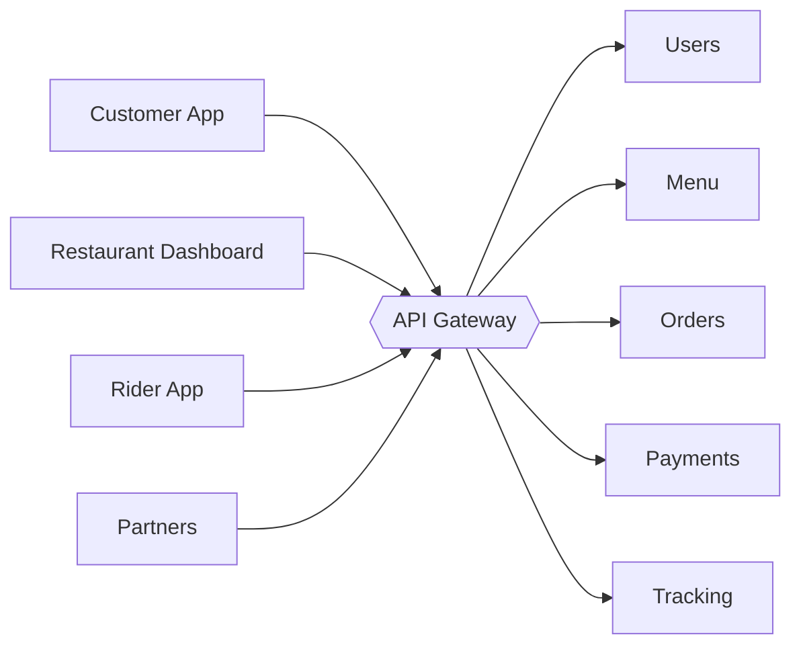
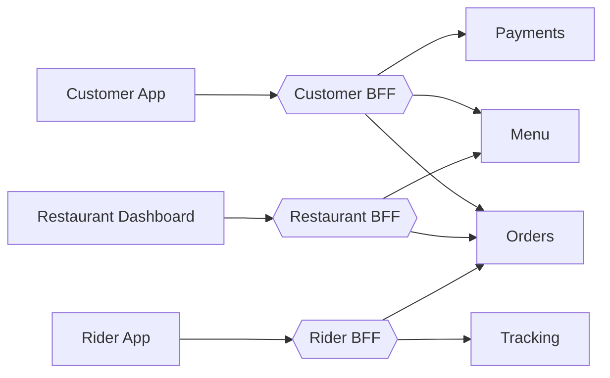
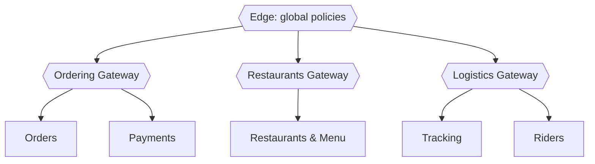

# Part 4 — Gateway Topology Patterns (~4 min)

## Slide 9 — Pattern 1: Single Gateway

**On slide:**

> One gateway for every client and every service.

| ✅ Pros | ❌ Cons |
|---|---|
| Simple to set up and run | Every client gets the same API shape |
| One place for all policies | Grows into a huge shared config |
| Lowest cost | One team becomes the bottleneck |
| | One failure or bad change affects everyone |

**Best for:** small teams, few client types, early-stage products

**Visual:**

**Speaker notes (~50s):**
- "The simplest option: one gateway in front of everything. This is where MyFood started, with a small team, one app and a few services."
- "It's genuinely the right choice at the start. One place to configure, one thing to monitor, lowest cost."
- "The problems appear as you grow. The mobile app wants small payloads, the restaurant dashboard wants rich data, partners want stable contracts, but they all share one API. Every team edits the same config, and one bad change affects every client."

---

## Slide 10 — Pattern 2: Backend for Frontend (BFF)

**On slide:**

> One gateway (or thin backend) **per client type**, shaped for that client.

- **Customer App BFF:** small payloads, aggregated home screen
- **Restaurant Dashboard BFF:** richer data for order management
- **Rider App BFF:** frequent location updates, delivery jobs

✅ Each client gets exactly what it needs · Owned by the client's team
❌ More things to run · Some duplicated logic

MyQuestions: What's the difference between BFF and just routing the client request direct to the service since the BFF is now implemented per service

**Visual:**

**Speaker notes (~1 min):**
- "Backend for Frontend, or BFF, is a pattern popularised by Sam Newman. Instead of one general-purpose gateway, each client type gets its own."
- "For MyFood: the customer app needs small, aggregated responses because it's on mobile data. The restaurant dashboard needs detailed order data. The rider app sends location updates every few seconds. Three very different needs."
- "Each BFF is owned by the team that builds that client, so the mobile team can change their API without a meeting with the dashboard team."
- "The cost: more things to deploy and some duplication. Keep shared concerns like auth in the edge gateway, and keep BFFs focused on shaping data for their client."
- APIM: "In practice, a common setup is one APIM instance at the edge with separate APIs and products per client, and small BFF services (for example in FastAPI) behind it for the heavier aggregation."

---

## Slide 11 — Pattern 3: Domain / Team Gateways

**On slide:**

> Split gateways by **business domain** or **team**, with shared guardrails on top.

- **Ordering:** Orders, Payments
- **Restaurants:** Restaurants & Menu
- **Logistics:** Delivery Tracking, Riders

**Federated ownership:**
- Platform team → the gateway platform + global policies (security, logging)
- Domain teams → their own APIs and policies

**In APIM:**
- **Policy scopes:** All APIs → Product → API → Operation
- **Workspaces** (Premium tiers): teams manage their own APIs in a shared instance
- **Self-hosted gateway:** run the gateway close to your services (e.g. in Kubernetes)

**Visual:** Left: a diagram of the edge gateway with three domain gateway boxes (Ordering, Restaurants, Logistics), each owned by a team, with a "global policies" band across the top. Right: **screenshot** of APIM **policy scopes**: the policy editor at the "All APIs" level, showing that global policies apply to every API.

**Speaker notes (~1 min):**
- "As MyFood grows to several teams, a different split makes sense: by business domain. The Ordering team owns its gateway and APIs, the Restaurants team owns theirs, and so on."
- "The key idea is *federated ownership*. A platform team owns the gateway platform and the global rules, like 'every request must have a valid token and a correlation ID'. Domain teams own everything specific to their APIs."
- APIM: "APIM supports this with policy scopes. A policy at the 'All APIs' level applies everywhere; teams add their own at the API or operation level. On the Premium tiers, *workspaces* go further and give each team its own area inside a shared instance."
- "The self-hosted gateway lets you run the APIM gateway inside your own Kubernetes cluster, close to your services, while still managing it from Azure."

---

## Slide 12 — Comparing the Patterns

**On slide:**

| | Single Gateway | BFF | Domain / Team Gateways |
|---|---|---|---|
| **Split by** | Nothing | Client type | Business domain / team |
| **Best for** | Small teams, early stage | Very different clients | Many teams, large systems |
| **Complexity** | Low | Medium | Higher |
| **Main risk** | Becomes a bottleneck | Duplication | Inconsistent standards |

**Decision guide:**
1. **Start** with a single gateway
2. Clients need very different APIs? → add **BFFs**
3. Teams blocking each other on gateway changes? → split by **domain**

> These combine: an edge gateway + BFFs + domain gateways is common.

**Visual:** The table above, plus a simple 3-step flowchart for the decision guide.

**Speaker notes (~1 min):**
- "There's no single right answer; it depends on your clients and your teams."
- "My advice: start simple. One gateway. Move to BFFs when your clients' needs really start to differ, and move to domain gateways when teams start blocking each other."
- "These patterns aren't mutually exclusive. Many real systems have one edge gateway for global security, BFFs for client-specific shaping, and domain ownership for the APIs behind them. That's roughly where MyFood ends up, as we'll see in Part 7."
- "If your team structure and your gateway structure don't match, you'll feel it. This is Conway's Law: your architecture tends to mirror how your teams communicate."
