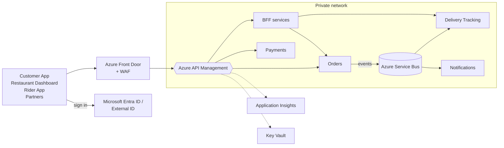
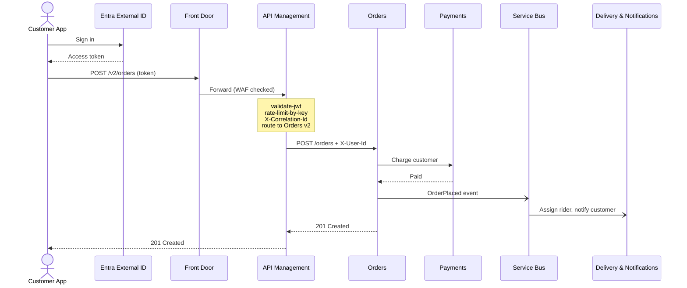

# Part 7 — Putting It Together (~2 min)

## Slide 18 — Reference Architecture on Azure

**On slide:**

- **Azure Front Door:** global entry point + web application firewall
- **Azure API Management:** the gateway: auth, routing, rate limits, versioning
- **Services:** AKS, Container Apps or Functions, in a **private network**
- **Microsoft Entra ID / External ID:** issues tokens
- **Azure Service Bus:** events between services (east–west)
- **Application Insights:** logs, metrics, traces
- **Key Vault:** secrets and certificates

**Visual:**

**Speaker notes (~1 min):**
- "Here's how everything fits together on Azure."
- "Clients sign in with Entra ID and get a token. Every request hits Front Door first, which blocks common attacks with its firewall and routes to the nearest region."
- "Front Door forwards to APIM, our gateway. APIM validates the token, applies rate limits, adds the correlation ID and routes the request: either straight to a service, or to a BFF for client-specific shaping."
- "All the services sit in a private network, so the *only* way in is through APIM. That's the 'no walking around the gate' rule."
- "Services talk to each other east–west through Service Bus events, not through the gateway."
- "Everything reports to Application Insights, and secrets live in Key Vault, which APIM reads through named values."

---

## Slide 19 — MyFood, End to End: Placing an Order

**On slide:**

Follow one order through the system:
1. Customer signs in → gets a token
2. `POST /v2/orders` → Front Door → APIM
3. APIM: validate token ✔ rate limit ✔ correlation ID ✔ route to Orders `v2` ✔
4. Orders creates the order, calls Payments
5. Orders publishes `OrderPlaced` → Delivery & Notifications react
6. `201 Created` back to the customer

**Visual:**

**Speaker notes (~1 min):**
- "Let's follow one order to see every concept from today in action."
- "The customer signs in and gets a token. They tap 'Place order' and the app sends `POST /v2/orders`. Notice the `v2`: this customer has the latest app."
- "Front Door checks for attacks and forwards to APIM. APIM validates the token (security), checks the rate limit (traffic control), adds a correlation ID (observability) and routes to Orders version 2 (routing and versioning)."
- "Orders handles the *business* logic: is the restaurant open, is the item available. That's the thin-gateway rule. It calls Payments directly, east–west."
- "Then it publishes an `OrderPlaced` event. Delivery assigns a rider and Notifications tells the customer. Neither of those touches the gateway."
- "The customer gets `201 Created`. If anything fails, one correlation ID shows the whole journey in Application Insights."
